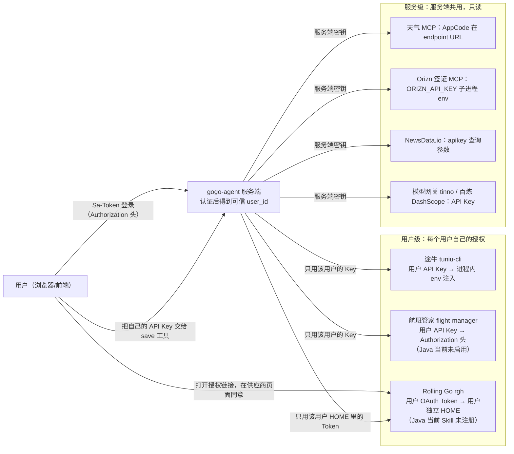

# 055 第三方鉴权授权图：用户 → 服务 → 供应商

> 状态：契约与数据已落地（[`credentials.py`](../../src/gogo_agent/security/credentials.py)），**授权方全部是替身**，没有访问任何真实供应商。清单来自对 Java 源码的静态核对（相对 `/Users/shenmingjie/workSpace/LLMentor-teach/gogo-agent/src/main/java/com/gogo/travel/` 与 `src/main/resources/`），未运行 Java 应用。逐步调试见 [阶段 E 050–059 调试指南](阶段E-050-059-调试指南.md)。

## 一句话规则

- **用户级** provider（途牛、航班管家、Rolling Go）：只认当前认证用户自己的凭证。缺失就失败，**不**回退到其他用户、管理员或服务级密钥。
- **服务级** provider（天气 MCP、签证 MCP、资讯、模型网关、百炼）：所有用户共用服务端凭证，只用于清单里明确标为服务级的 provider，且这些能力只读。
- 凭证不进入提示词、源码、日志、异常文本、工具响应或模型上下文。

## 授权图

读图方法：左边的“用户→服务”一跳只证明是谁（Java 用 Sa-Token，Python 用已有 `auth` 包）；右边的“服务→供应商”一跳才由本编号的 `CredentialResolver` 决定“这次请求用谁的授权”。用户级 provider 的 `authorized_as` 是该用户标识；服务级的是 `service:<provider>`，所以日志和审计里能区分“用户自己的账号下单”与“共用服务账号只读查询”。

## 每个集成的持有者、资源、过期与撤销

| provider | 凭证形态 / 持有者 | 可访问资源 | 更新 / 过期 | 撤销方式 | Java 当前是否注册调用入口 |
| --- | --- | --- | --- | --- | --- |
| `tuniu-cli` | `cli_env_var` / **用户** | 该用户途牛账号下机票、酒店、火车票查询与下单，订单在用户自己的账号里 | 用户在途牛开放平台领取的长期 API Key，无自动刷新 | 用户在途牛平台作废；本系统 `ApiKeyService.revoke` 清空密文 | 是：`ItineraryPlanAgent.java:127`、`BookingAgent.java:110` 注册 Skill；`ApiKeyTools` 的 `check/save_tuniu_api_key` 注册在 Plan、Booking（`ItineraryPlanAgent.java:69`、`BookingAgent.java:75`） |
| `flight-manager` | `user_api_key` / **用户** | 该用户航班管家账号下机票查询、预订、退改签、发票（Skill 说明） | 用户在 h5.133.cn 领取的长期 API Key | 用户在平台作废；`ApiKeyService.revoke` | **否**：Skill 资源存在但未注册；`ApiKeyTools` 的 flight 工具已注释；`FlightApiKeyHook` 仍挂在 Hook 链上 |
| `rolling-go-hotel`（rgh） | `user_oauth_token` / **用户** | 该用户 Rolling Go 账号下酒店订单读取、预订、取消（OAuth scope） | Token 在 Redis 保存 30 天（`RghTokenStore`）；CLI 可能刷新；过期要重新授权 | `rgh logout`：Java 同时清 Redis 与本地文件；供应商侧授权由用户在平台撤销 | **否（Skill 未注册）**：`RghUserIsolationHook` 仍在 Hook 链、`ItineraryPlanAgent.java:131` 的 shell 白名单含 `rgh`；**运行时是否真的被调用没有调用证据** |
| `weather-mcp` | `mcp_credential` / **服务** | 天气预报，只读 | 随云市场订阅；AppCode 内嵌 endpoint URL | 运维在云市场重置 AppCode 并改 `WEATHER_MCP_ENDPOINT` | 是：`InfoAgent.java:58`、`ItineraryPlanAgent.java:73` |
| `orizn-visa-mcp` | `mcp_credential` / **服务** | 签证要求查询，只读；无 Key 时只暴露免费工具 | 长期 Key，经 `ORIZN_API_KEY` 注入 `npx` 子进程 | 运维在 visa.orizn.app 重置并更新配置 | 是：`InfoAgent.java:59`、`ItineraryPlanAgent.java:74` |
| `newsdata-io` | `service_api_key` / **服务** | 目的地资讯，只读，免费额度全服务共用 | 长期 Key，`apikey` 查询参数 | 运维重置并更新 `app.news-api-key` | 是：`InfoAgent.java:57`、`ItineraryPlanAgent.java:70` |
| `llm-gateway` | `service_api_key` / **服务** | 对话/意图/规划模型调用，费用记服务账号 | 长期 Key | 运维在网关作废并更新配置 | 是：`ModelConfig.java:23-64` |
| `dashscope-bailian` | `service_api_key` / **服务** | embedding、RAG、长期记忆；数据按 userId 区分，凭证不区分 | 长期 Key 与 AccessKey | 运维在阿里云作废并更新配置 | 是：`RagKnowledgeConfig.java:36-87` |

不在清单里的：`wttr.in` 天气（`DestinationLiveTools` 的 `query_weather`）无需任何凭证；Sa-Token 登录 Token 是“用户→服务”的会话凭证，不是第三方授权。

**`CredentialKind` 的取值**：除任务要求的服务级 API Key、用户级 OAuth Token、CLI 环境变量、MCP 凭证外，还有一个 `USER_API_KEY`（用户自己的 API Key 通过请求头注入）。原因是 Java 的 `flight-manager` 用 `Authorization: Bearer ${FLIGHT_API_KEY}` 请求头承载用户自己的 Key，既不是服务级也不是 CLI 环境变量；强行归入任一类都会让 `kind` 与实际不符。

## “某次供应商请求使用谁的授权”怎么回答

`CredentialResolver.resolve(user_id, provider)` 返回 `AuthorizationDecision`（不含密钥）：

| 字段 | 例：alice 调途牛 | 例：alice 调天气 |
| --- | --- | --- |
| `holder` | `user` | `service` |
| `authorized_as` | `alice` | `service:weather-mcp` |
| `credential_ref` | `user:tuniu-cli:alice` | `service:weather-mcp` |
| `integration_enabled` | `True` | `True` |

无法授权时抛出稳定错误码，**没有兜底**：

| 错误码 | 触发 |
| --- | --- |
| `CREDENTIAL_PROVIDER_UNKNOWN` | 集成清单里没有该 provider |
| `CREDENTIAL_USER_REQUIRED` | 没有可信用户标识 |
| `CREDENTIAL_USER_NOT_CONFIGURED` | 用户级 provider 且该用户没有自己的凭证（即使服务级里配了同名 provider、即使 alice 或管理员有 Key） |
| `CREDENTIAL_SERVICE_NOT_CONFIGURED` | 服务级 provider 且服务端未配置 |

## 057 的核对结论：源项目是否实际使用 PKCE

- **Java 仓库里没有任何 PKCE 实现**：对 `src/main` 全文检索 `code_verifier`、`code_challenge`、`pkce`、`state=` 没有命中（JSON 数据文件除外）。
- PKCE 由第三方 `rgh` CLI（npm 包 `@rollinggo/hotel`）执行；文章 057 描述了它的流程（生成 `code_verifier`/`session_id`、SHA256 得 `code_challenge`、向中转服务 `/init` 取 `state`、轮询 `/token`）。**rgh 源码不在 Java 仓库里，我没有读到，上述流程只来自文章，未验证。**
- Java 只负责三件事，都在 `RghUserIsolationHook`：用户独立 `HOME`、把 `rgh login` 改写为后台执行并快速返回授权链接、Token 文件与 Redis 之间的同步和捕获。
- 所以 Python 的真实边界是 [`exercises/rgh_workspace.py`](../../src/gogo_agent/security/exercises/rgh_workspace.py)；[`pkce.py`](../../src/gogo_agent/security/pkce.py) 里的应用内 `PkceLoginService` 是教学练习，**Java 没有对应实现**，只有确需接管时才使用。文章里“把 `code_verifier` 发给中转服务”这一点与教科书 PKCE 不同，模拟授权方没有复刻。
- rgh 对应的 Skill 在 Java 当前规划/预订 Agent 里**未注册**（见上表），因此 051/057 的 CLI 边界不算已迁移业务功能。
