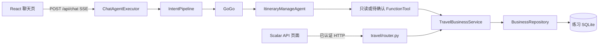

# 阶段 D：用聊天页、Scalar 和断点学会 029–041

本指南面向从 Java 转到 Python AgentScope 的工程师。先走一遍可见页面，再分别追踪意图、Agent、工具、业务事务和数据库；每次实验先写预测，执行后只用 HTTP/数据库结果核对，不用 AI 回答替代事实。阶段 D 的 Java/Python 逐方法对照见[029–041 调试指南](阶段D-029-041-调试指南.md)。

## 先认清三个入口



聊天页能登录、发消息、看 SSE 回复与推荐问题、查看历史和反馈；它**没有“我的差旅”、联系资料、预订或管理员审批表单**。聊天里的提交、修改、取消工具只返回待确认建议。真正写入必须通过已认证的 `/api/my-travel` 或管理员 HTTP 入口。因此浏览器练习需同时开两个标签：React 聊天页和后端的 `/scalar`。第三个入口是 `scripts/`：用于稳定复现纯业务函数、缓存到期、DOCX 重建和思考参数，避免把模型随机回答当成单元测试。

2026-10-07 检查时，现有 PyCharm 后端 `127.0.0.1:8000` 和 Vite `127.0.0.1:5173` 均能响应。它们指向 `.env` 数据库；那里的阶段 D 新表目前为空，`user_profile` 没有职级，政策查询返回 `PROFILE_LEVEL_MISSING`。下方使用独立的 `8001/5174` 和临时 SQLite，不会改动 `.env` 数据库，也不占用当前调试进程。

## 0. 十分钟准备：新建浏览器练习库

从仓库根目录执行：

```sh
cd /Volumes/PortableSSD/workspace/gogo-agent
uv sync --locked
PYTHONPATH=src .venv/bin/python scripts/prepare_stage_d_browser_lab.py
```

脚本打印一条实际的 `GOGO_DATABASE_URL=sqlite+pysqlite:////.../lab.sqlite` 和两条可复制的启动命令。每次运行都会创建一份新的系统临时 SQLite；它拒绝覆盖已有文件，不读取 `.env` 中的数据库地址。练习库含九张表、Alice `u001/P6`、Bob `u002/P5`、管理员 `u_001/P8`；三个账号的**本地练习密码**都是 `123456`。另有 Alice 的模拟酒店 `lab-hotel-037` 和模拟机票 `lab-flight-037`，最初没有差旅单。账号密码只适用于这份临时库，别拿来判断正式库的登录状态。

### 后端：推荐用一个没有 reload 的 PyCharm Debug 配置

- Run/Debug Configurations → 新增 Python；**Module name** 填 `uvicorn`。
- Parameters 填 `gogo_agent.api:app --host 127.0.0.1 --port 8001`。
- Interpreter 选本仓库 `.venv/bin/python`；Working directory 选本仓库根目录。
- Environment 至少填 `PYTHONPATH=src`、刚打印的 `GOGO_DATABASE_URL=...`、`GOGO_REDIS_HOST=`（空值）。模型网关配置继续从仓库 `.env` 读取。
- 以 **Debug** 启动。此配置不加 `--reload`，断点停在同一个后端进程。若直接 Debug `main.py`，它默认 `reload=True`，要确认 PyCharm 已跟踪重载后的子进程。

等价终端命令由准备脚本直接打印。不要把 `GOGO_DATABASE_URL` 写回仓库 `.env`；只给这一轮后端进程设置。

### 前端：另起 Vite 实例

```sh
cd /Volumes/PortableSSD/workspace/gogo-agent/frontend
npm ci
GOGO_API_PROXY_TARGET=http://127.0.0.1:8001 npm run dev -- --host 127.0.0.1 --port 5174
```

打开 `http://127.0.0.1:5174`，以 Alice 登录。另开 `http://127.0.0.1:8001/scalar`。前端 `5174` 的 `/api` 被 Vite 代理到练习后端 `8001`；`5173` 仍指向它原来的后端，不要混用。若 `node_modules` 已安装且未改依赖，`npm ci` 可省略。

Scalar 是独立站点，不会自动使用 `5174` 页面 Local Storage 的 Token。在 Scalar 中先调用 `POST /api/auth/login`，请求体 `{"username":"alice","password":"123456"}`；复制响应的 `token`，在后续每个受保护操作的 `Authorization` 请求头填**原始 token**或 `Bearer <token>`。切换到 Bob/管理员时分别重新登录并换对应 token。不要把 token 粘贴进 AI 对话或本指南的练习记录。

### 浏览器开发者工具先开好

在 `5174` 页面按 F12：Network 选择 Fetch/XHR，打开 **Preserve log**；发送消息后点 `POST /api/chat/{sessionId}`，查看 Request Payload 的 `message`、Request Headers 的 `Accept: text/event-stream`、Response/EventStream 中的 `message`、`message_id`，以及可选的 `suggestions`。登录时可看 `POST /api/auth/login`、`GET /api/auth/info`；历史和反馈会产生 `GET /api/chat/conversations`、`GET /api/chat/{sessionId}/messages`、`PUT .../feedback`。`Application → Local Storage → 5174 → gogo-auth` 是前端本地登录态；只观察，不复制 token 给 AI。

SSE 现已通过 `thinking/progress` 展示真实主子 Agent 与工具调用，可展开参数、结果和模型实际返回的思考；没有思考内容时明确提示。成功保存后从 `extra.timeline` 回放，详见[执行过程时间轴调试指南](执行过程时间轴-调试指南.md)。要核对模型是否真的调用了 `itinerary_manage_agent`，仍可在 Scalar 用同一会话 ID 调 `GET /api/chat/{sessionId}/messages`，查看本轮助手消息的 `extra.tool_calls` 和 `extra.intent_pipeline`。用 `trace_id` 对照 PyCharm 控制台日志；模型调用日志记录角色、耗时与 token，不记录对话正文。

浏览器的 `sessionId`、`messageId`、`order_id`、`approval_id`、Token 与追踪号每次会变。把本轮 `order_id`/`approval_id` 临时记在本地笔记，用于下一步；别把它们当固定样例值。脚本演示的 `--case all` 每项重建内存库，浏览器练习库则会持续保留前一操作的状态。

## 1. 每一步统一记录四件事

在点击“发送”或 Scalar 的 Send 前，先预测：**①意图/入口；②会进入哪个 Agent、工具和函数；③HTTP/SSE 结果；④数据库状态是否改变。** 操作后再按这个顺序核对。HTTP `200` 只表示接口成功，不等于供应商订单成功；AI 说“已提交”也不能代替 `GET /orders` 的结果。

Java 类比：FastAPI `Depends(get_current_user)` 相当于服务端认证拦截并注入可信身份；Pydantic 请求模型相当于 DTO 校验；`FunctionTool` 相当于模型可见的 `@Tool`；`with repository.transaction()` 是显式事务边界，类似 `@Transactional`；`AgentState` 是模型上下文，`chat_message` 是用户可见业务历史，两者不能混看；SSE 的 `message_id` 表示回答已保存，`suggestions` 是随后单独生成的推荐。

## 2. 029–034：从聊天入口读到业务边界

每次要观察**新请求意图识别**时，先在左侧点“新建对话”。输入下面的原句，别一次把多种动作混在一条消息里；这些原句已用本地 `IntentRuleMatcher` 验证会命中所列类别。模型是否真的发起工具调用仍由模型决定，需看持久消息的 `extra.tool_calls`；若想稳定进入指定工具，用阶段 D 离线脚本的相应 `--case`。

| 编号 | 在 React 聊天页输入 / 在 Scalar 操作 | 先预测并核对 | 建议断点 |
| --- | --- | --- | --- |
| 029 | 聊天：“查我的差旅单” | L1 `travel_order_query` → GoGo 可见 `itinerary_manage_agent`；练习库初始无订单。若工具没有被模型调用，`tool_calls` 为空，不能把自然语言回复当成已读库证据。 | `chat/executor.py:230` `_build_agent()` 的 `has_manage`；`:212` `_build_manage_agent()`；`travel/tools.py:29` `build_manage_toolkit()`。 |
| 030 | Scalar `POST /api/my-travel/orders`，先把 `return_date` 写成早于 `departure_date`，或漏掉 `purpose` | HTTP `422`，不会创建订单；验证发生在业务服务调用前。 | `travel/models.py:66` `validate_date_range()`；`travel/router.py:37` `submit_order()`。 |
| 031 | Alice 后续创建订单后，Bob 用自己的 Scalar token 调 `GET /api/my-travel/orders/{Alice的order_id}` | Bob 得 `404 ORDER_NOT_FOUND`；请求体/聊天文字中的 `userId` 不能改变认证身份。 | `travel/tools.py:29` 闭包的 `user_id`；`travel/repository.py:39` `order()` 的双条件。 |
| 032 | 聊天：“查询上海的差旅政策”；Scalar `GET /api/my-travel/policy?city=上海` | L1 `policy_query`；练习 Alice 为 P6，上海酒店每晚上限为 500。精确金额来自政策函数，不来自文档相似度。 | `travel/service.py:194` `query_policy()`；`travel/policy.py:58` `select()`。 |
| 033 | Scalar `GET /api/my-travel/profile`、`GET /profile/completeness?biz_type=HOTEL`，再 `PATCH /profile` 用 `{"phone":"13800000001","name_pinyin":"ZHANG SAN","email":"alice@example.test"}` | 起初酒店资料有缺项；PATCH 后本人的缺项减少。再试 `{"level":"P9"}` 应为 `422`，用户不能自改职级。 | `travel/models.py:174` `UserProfilePatch`；`travel/service.py:170` `update_profile()`、`:184` `profile_completeness()`。 |
| 034 | Scalar `GET /api/my-travel/policy/knowledge?question=上海酒店住宿标准`，再问“量子火箭推进器” | 前者返回带 `source/version/chunk_id` 的脱敏片段；后者应为空列表。词面索引不能给出精确额度。DOCX 更新/重建需跑离线脚本，聊天页没有上传入口。 | `travel/knowledge.py:87` `retrieve()`；`scripts/demo_034_policy_knowledge.py`。 |

**易错的提示词对照**：本地规则验证“查询上海的差旅政策”命中 `policy_query`；“上海酒店每晚上限是多少”却命中 `hotel_search`。学习 032 时明确说“差旅政策”，否则你可能调试到尚未实现的酒店搜索职责。另开新对话说“请规划北京到上海两日行程”会命中 `itinerary_planning`，但阶段 E 的 PlanAgent 尚不存在；这正是 029 管理与规划职责的分界。

034 的文档重建不能靠网页操作完成；执行 `PYTHONPATH=src .venv/bin/python scripts/demo_034_policy_knowledge.py`，在 `travel/knowledge.py:45` 的 `build_policy_corpus()` 和 `:87` 的 `retrieve()` 打断点。真实 DOCX 可用 `scripts/build_policy_corpus.py` 导入到**新** JSON 文件，再用 `GOGO_POLICY_CORPUS_PATH` 指向它并重启练习后端。

## 3. 035–038：一条完整的订单与审批链

以下操作连续使用**同一份浏览器练习库**。Scalar 中保持 Alice token；管理员步骤才切换 token。每个 JSON 均可直接粘进 Scalar 请求体。日期来自 2026-10-07 的教学样例；以后重做可换成当时的未来日期。当前服务只校验返回日不早于出发日，因此即使样例日期已过，状态练习仍可复现。

### 035：先证明聊天不会写库，再提交

1. React 新建对话，输入：“我要申请出差，从北京去上海，2026-11-10 出发，2026-11-12 返回，事由是客户拜访，请先给出待确认摘要”。本地规则命中 `travel_application`。管理工具 `submit_travel_approval` 只返回 `CONFIRMATION_REQUIRED`；即使回复里出现“确认”，此时 Scalar `GET /api/my-travel/orders` 仍应是空列表。再在聊天里发“确认”，也不会自动走数据库写入。断点：`travel/tools.py:103` `submit_travel_approval()`。
2. Scalar `POST /api/my-travel/orders` 先用同一请求体的 `confirmed:false`：

   ```json
   {"destination":"上海","departure_city":"北京","departure_date":"2026-11-10","return_date":"2026-11-12","purpose":"客户拜访","confirmed":false,"idempotency_key":"lab-submit-001"}
   ```

   预期 `409 CONFIRMATION_REQUIRED`，订单仍为 0。只将 `confirmed` 改成 `true` 再发送，预期 `200`、订单 `SUBMITTED`、`approval_id` 非空。记录动态的 `order_id` 与 `approval_id`。断点：`travel/service.py:310` `_require_confirmed()`、`_replay()`、`_new_approval()`；`travel/repository.py` 的 `transaction()`。
3. 用相同的 `idempotency_key` 和相同字段再发一次，预期**同一个** `order_id`；同一键只改 `purpose`，预期 `409 IDEMPOTENCY_CONFLICT`。用 `GET /orders/{order_id}/approvals` 看一条 `PENDING`，而不是两条。之后 React 新建对话说“查我的差旅单”“查询我的审批状态”，对比页面文字与 Scalar 的确定性记录。

### 036：冲突检测只读，且不会在提交时自动触发

Scalar `POST /api/my-travel/conflicts`，请求体：

```json
{"destination":"杭州","departure_city":"北京","departure_date":"2026-11-10","return_date":"2026-11-12","purpose":"另一场会议"}
```

它与刚创建的北京→上海订单日期重叠、路线不同，预期 `HIGH` 冲突；再加查询参数 `exclude_order_id=<刚创建的 order_id>`，应排除自身。断点：`travel/service.py:275` 构造候选段与筛选本人订单，`travel/conflict.py:45` 比较闭开区间。缺少城市交通时长时结果进入 `uncertain`。**提交订单不会自动调用这个端点**；要学会把“建议先检查”与“服务强制检查”区分开。

### 038 与 035：管理员同意、强制修改、再次审批、取消

1. Alice token 调 `POST /api/admin/approvals/{approval_id}/decision`，body `{"decision":"agree","remark":"浏览器练习"}`，预期 `403`。用管理员账号在 Scalar 重新登录，换管理员 token 同样请求，预期审批 `APPROVED`；Alice 再用自己的 token `GET /orders/{order_id}`，订单也是 `APPROVED`。断点：`travel/service.py:413` `decide_approval()`，看先锁订单、再锁审批，同一事务改两行。
2. Alice token 调 `PUT /api/my-travel/orders/{order_id}`，body `{"confirmed":true,"idempotency_key":"lab-modify-001","force":false,"changes":{"destination":"杭州"}}`，预期 `409 FORCE_CONFIRMATION_REQUIRED`。只把 `force` 改为 `true` 再发，预期旧审批 `CANCELLED`、新审批 `PENDING`、订单回到 `SUBMITTED`。新 `approval_id` 会变，原 `order_id` 不变。断点：`travel/service.py:342` `modify_order()` 与 `travel/repository.py:45` `order_for_update()`。
3. 管理员用**新** `approval_id` 再同意；Alice 用 `POST /api/my-travel/orders/{order_id}/cancel`，body `{"confirmed":true,"idempotency_key":"lab-cancel-001","force":false}`，预期 `409`。改成 `force:true` 再发，预期订单 `CANCELLED`、当前审批 `CANCELLED`。用 `GET /orders/{order_id}/approvals` 解释为什么一张订单现在有多条审批记录。断点：`travel/service.py:381` `cancel_order()`。
4. `POST /api/callback/dingtalk/approval` 即便伪造 `{"decision":"agree"}` 也固定返回 `503`，不能改变订单；来源签名尚未接入，不把它当真实回调调试。

### 037：模拟预订记录

练习库先有两条 Alice 记录；Bob 的 `GET /api/my-travel/bookings` 应为空。Alice `GET /bookings?biz_type=HOTEL` 能看到 `lab-hotel-037`。对它调用 `POST /bookings/lab-hotel-037/cancel`，body `{"confirmed":true,"idempotency_key":"lab-hotel-cancel-001"}`，预期本地 `CANCELLED`、`supplier_cancelled:false`，需要联系酒店确认。对 `lab-flight-037` 使用另一个幂等键取消，默认供应商网关返回 `503 SUPPLIER_UNAVAILABLE`，再次 GET 仍为 `CONFIRMED`。断点：`travel/service.py:459` `cancel_booking()`。当前没有创建真实供应商预订的 HTTP 入口，React 也没有预订表单；这两条记录只供学习状态边界。

## 4. 039–041：看不到页面按钮的内部机制

| 编号 | 怎样做 | 断点观察与正确解释 |
| --- | --- | --- |
| 039 缓存 | Alice 在 Scalar 连续两次 `GET /api/my-travel/policy?city=上海&on_date=2026-10-07`，然后 Bob 同样查询；Alice PATCH 自己的 `base_city` 后再查询。 | `travel/cache.py:24` `get_or_load()`：Alice 第一次 `current=None`，第二次命中；Bob 的 user_id 不同，不共享；资料更新后 Alice 项失效。TTL 300 秒，想快速观察到期可用 `scripts/demo_029_040_stage_d.py --case 039` 的注入时钟。缓存只在当前进程内，多进程不共享。 |
| 040 推荐 | React 新建对话，问“查我的差旅单”。在 DevTools 看 `message` → `message_id` → 可选的 `suggestions`；若显示推荐问题 chip，点一下再看它触发新的 `POST /api/chat/{sessionId}`。 | `chat/executor.py:656` `_stream_prepared_turn()` 先保存回复，再调 `:153` `recommend_questions()`；`frontend/src/components/ChatWindow.tsx:362` 解析 chips。模型可能返回空列表，所以没有 chip 不等于主答复失败。JSON `Accept: application/json` 路径只返回三字段，不带推荐。 |
| 041 思考参数 | 运行 `PYTHONPATH=src .venv/bin/python scripts/benchmark_041_thinking.py`；需要真实网关对照时才加 `--live`，会产生六次模型请求。 | `chat/executor.py:132` 当前聊天角色 `thinking_enable=False`；基准脚本记录同三题两档的耗时、JSON 有效性和误调用数。React 没有思考开关。PlanAgent 的规划/执行/总结 Hook 属阶段 E，不能从当前页面验证。 |

## 5. 如何判断自己真正学会了

关掉代码，逐题先写预测，再通过浏览器/API/断点解释原因：

1. 聊天说“确认”之后，差旅单表会增加吗？**不会。** 模型工具只提待确认建议；真正写入入口是带认证、`confirmed` 和幂等键的 HTTP 请求。
2. Bob 在聊天文字里写 `userId=u001`，或用 Bob token 查询 Alice 的 `order_id`，能读到吗？**不能。** `user_id` 由 Token 得到，仓储按所有者再过滤。
3. P6 上海酒店金额为 `500`、`500.01`、缺失时，合规结果依次是什么？**合规、不合规、不合规。** 文档检索结果不能覆盖结构化金额判断。
4. 已审批的订单不传 `force` 就修改，旧审批会动吗？**不会。** 请求 409；`force:true` 时才撤销旧审批并创建新审批。
5. 模拟酒店取消是否证明供应商已取消？**不能。** `supplier_cancelled:false`；模拟机票的默认供应商网关返回 503，内部状态保持不变。
6. `message_id` 与 `suggestions` 谁先到？**先有已保存回复的 `message_id`。** 推荐调用失败也不回滚主回复。
7. `InfoAgent` 回答后在**同一会话**完整发送“继续”与重新点“新建对话”后发送“继续”会一样吗？**不会。** 027 的 Info 活跃续跑只在有效旧会话命中；当前 Manage 状态虽保存，但没有注册为快速直续目标。请分别在 `_active_agent_for_turn()` 和 `_prepare_turn()` 看分支。

你能不看代码解释每项的 **入口 → 可信身份 → 工具/事务 → 可见事件 → 数据状态**，并亲自复现一个成功例和一个拒绝例，才算过关。若真实模型这次没有调用管理工具，改跑 `PYTHONPATH=src GOGO_DATABASE_URL='' .venv/bin/python scripts/demo_029_040_stage_d.py --case 029`；固定模型会稳定发起委派，便于检查代码调用链。
