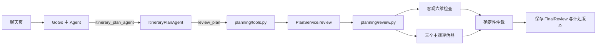

# 阶段 E：跟着规划链路调试审核（052–054 / 060）

你已经学完[前端触发规划 Agent 逐步调试](阶段E-前端触发规划Agent逐步调试.md)。这一篇从规划结果已经算出来的位置接着走，目标是亲手看懂：**谁发起审核、规则检查什么、三个模型分别做什么、谁决定最终结论，以及结论保存后什么时候失效。**

核对日期：2026-10-25。代码是权威；下面同时给文件、函数和具体语句，行号只用于本次定位。没有新增业务入口或另一套审核实现，离线练习复用现有 `scripts/demo_042_060_planning.py` 和专项测试。

## 先认清：现在没有单独运行的 ItineraryReviewAgent

旧文章中的“审核子智能体”，在当前 Python 实现里是**规划 Agent 的审核工具和工具内部评估流程**，不是 GoGo 再委派一个独立 ReAct Agent。



四个事实先记住：

1. GoGo 本轮挂的是 `itinerary_plan_agent`，不是 `itinerary_review_agent`。审核通过规划工具到达，**没有单独的审核意图或审核聊天接口**。
2. [`executor.py:_build_plan_agent`](../../src/gogo_agent/chat/executor.py) 创建一个 `role="review"` 的模型对象，再由 [`build_model_assessors`](../../src/gogo_agent/planning/assessors.py) 创建体验、韧性、偏好三个评估器；它们共享这个模型客户端，每个评估器各调用一次模型。
3. 客观检查与 Python 仲裁都不调用模型。一次审核若配置三个正常评估器，应有三次 `role=review` 调用；如果规划模型再次请求审核，调用数还会增加，不能把一次聊天固定理解为三次。
4. `success=True` 表示工具执行完成；`verdict` 才是审核判定。`pass`、`warning`、`fail` 都可能以工具成功结果返回。审核不提交差旅单、不审批、不预订。

## 0. 先选一条练习路线

| 路线 | 用途 | 模型与数据 |
| --- | --- | --- |
| A：离线 Python Debug，建议先做 | 稳定进入客观、主观、仲裁和版本断点 | 固定时间、模拟候选、内存 SQLite；053 使用脚本化模型，054/060 使用固定评估器 |
| B：已有前端练习环境 | 从一句话追到审核工具，认识真实装配 | 真实 GoGo/Plan/Review 模型；候选用假途牛 CLI；数据只进临时练习库 |
| C：pytest Debug | 稳定进入 FunctionTool 审核入口或坏 JSON 分支 | 真实工具/评估代码，测试替身，不连接共享库或真实模型 |

### A. 零准备离线命令

工作目录 `/Volumes/PortableSSD/workspace/gogo-agent`，解释器 `.venv/bin/python`，本次为 Python 3.12.13。没有环境时先运行 `uv sync --frozen`；已有环境直接用下面的命令，无需填写 Key、数据库或网关变量：

```sh
PYTHONPATH=src .venv/bin/python scripts/demo_042_060_planning.py --case 053
PYTHONPATH=src .venv/bin/python scripts/demo_042_060_planning.py --case 054
PYTHONPATH=src .venv/bin/python scripts/demo_042_060_planning.py --case 060
```

脚本会读写**独立的内存 SQLite**，不是完全没有数据库；它不连接 `.env` 指向的共享数据库，不请求真实模型或途牛。日期固定为“今天 2026-10-11，出发 2026-10-20，返回 2026-10-22”，因此不会因为现在日期变化而自动变成过期行程。

隐藏前置步骤必须算清楚：

- 每次新建 `PlanService` 后，先 `create → attach_candidates → compute`，才进入审核。到审核入口时已是 `version=3/content_version=3`，不是从空计划直接审核。
- 053 为三种主观情形各建一份服务；054 先对普通计划审核两次，再另外创建只保留 H3 的超标计划；060 自己创建新计划，与前两条命令不共用状态。
- 脚本注入 `ApprovedTrip(北京→上海)` 作为**固定城市对照数据**，不创建真实审批单，不表示用户已通过业务审批。普通聊天装配未注入这个值，所以两条路线的判定可能不同。
- `plan_id/review_id` 使用固定计数器，每个新服务从 `demo-001` 开始；浏览器中的 ID、模型输出和调用次数则会变化。不要混用两条路线的 ID。

PyCharm 新建 Python 配置：Script path 选 `scripts/demo_042_060_planning.py`，Working directory 选仓库根，Interpreter 选 `.venv/bin/python`，Environment 填 `PYTHONPATH=src`，Parameters 先填 `--case 053`。Debug 完后分别改成 054、060；不要一开始就跑 all，否则断点会跨多个独立样例反复命中。

### B. 接着使用前端练习环境

若之前的阶段 E 练习后端仍在运行，且确认它连接的是临时练习库，可以直接复用。需要重新准备时运行：

```sh
PYTHONPATH=src .venv/bin/python scripts/prepare_stage_e_browser_lab.py
```

复制脚本打印的 `lab.env` 路径。新终端中先 `source <实际生成的 lab.env 路径>`，确认其中 `GOGO_DATABASE_URL` 指向临时 SQLite，再启动后端；**不要把尖括号占位路径原样粘贴运行**。

```sh
# 先在同一终端 source 实际 lab.env，再执行：
GOGO_PLAN_STORE= PYTHONPATH=src .venv/bin/python -m uvicorn gogo_agent.api:app --host 127.0.0.1 --port 8082
```

另一个终端：

```sh
cd /Volumes/PortableSSD/workspace/gogo-agent/frontend
GOGO_API_PROXY_TARGET=http://127.0.0.1:8082 npm run dev -- --host 127.0.0.1 --port 5175 --strictPort
```

使用 `http://127.0.0.1:5175` 和 `http://127.0.0.1:8082/scalar`，练习账号 `alice / 123456`。8082/5175 只是避免和已有实例混用；不要转向原来的真实数据库实例。模型配置仍从仓库 `.env` 获取，真实模型调用会产生请求；假途牛 Key 只供假 CLI 使用。

PyCharm 后端 Debug 用 **Module name=uvicorn**，Parameters=`gogo_agent.api:app --host 127.0.0.1 --port 8082`，不要加 `--reload`；解释器、工作目录和练习变量沿用规划指南。另加 `GOGO_PLAN_STORE=` 空值表示按数据库自动装配；`memory` 才是强制使用内存库。保留 `NO_PROXY/no_proxy=localhost,127.0.0.1`，避免旧指南记录的 IPv6 代理解析问题。

**当前存储事实与旧规划指南有变化**：[`planning/dependencies.py`](../../src/gogo_agent/planning/dependencies.py) 有可用数据库时会使用关系库存储并尝试创建 `itinerary_plan`；无数据库、显式 memory 或建表失败回落时才用内存 SQLite。准备脚本建立 10 张基础表，首次初始化规划服务可能再建计划表。浏览器刷新本身不会清掉后端计划；重启是否丢失取决于实际存储。不要只从“页面找不到计划”推断它在内存。

### C. 稳定进入工具入口和异常出口

下面两条命令不需要前端或真实网关：

```sh
PYTHONPATH=src .venv/bin/python -m pytest tests/test_042_060_planning.py::test_043_full_tool_path_reaches_review_without_order_writes -q
PYTHONPATH=src .venv/bin/python -m pytest tests/test_053_subjective_review.py -q
```

在 PyCharm 中可直接 Debug 对应测试函数。第一条会依次调用真实 `create_plan → search_candidates → compute_plan → review_plan` FunctionTool，适合从第 3 节的 A2 开始跟踪；第二条适合检查模型回复格式。测试不证明真实模型一定会选择这些工具。

## 1. Java 与 Python：按职责对照，不按类名找对象

Java 根目录为 `/Users/shenmingjie/workSpace/LLMentor-teach/gogo-agent`，源码基目录为 `src/main/java/com/gogo/travel/`，下表 Java 路径均相对这个源码基目录。

| 职责 | Java 当前基线 | Python 当前入口 | 不能等同的地方 |
| --- | --- | --- | --- |
| 规划 Agent 挂审核工具 | `agent/ItineraryPlanAgent.java:64–78` 注册 `itineraryReviewTools` | [`chat/executor.py:_build_plan_agent`](../../src/gogo_agent/chat/executor.py) → `build_plan_toolkit` | Python 没有额外构造一个审核 ReAct Agent |
| 审核工具读取方案 | `agent/tools/ItineraryReviewTools.java:94–171` 的 `reviewItinerary`，工具名 `review_itinerary` | [`planning/tools.py:214`](../../src/gogo_agent/planning/tools.py) 的 `review_plan(plan_id, proposal_tag)` | Java 按用户和行程条件取结果；Python 按 user_id + plan_id 取计划，再选一个标签对应的方案 |
| 客观六维 | `agent/tools/review/ObjectiveReviewEngine.java:19–60` | [`planning/review.py:objective_review`](../../src/gogo_agent/planning/review.py) | 六维职责相似，具体严重等级仍以当前代码为准 |
| 三个主观评估 | `ItineraryReviewTools.runSubjectiveFanout` → `SubjectiveAssessorAgent` → `Pipelines.fanout` | [`assessors.py:build_model_assessors`](../../src/gogo_agent/planning/assessors.py) → `asyncio.gather` | Python 是三个普通评估器对象，不是三个带独立记忆的 ReAct Agent |
| 仲裁 | `agent/service/ReviewArbitratorService.java` 使用 stableModel，外层再守住客观硬失败 | [`review.py:arbitrate`](../../src/gogo_agent/planning/review.py) | **Python 仲裁是纯代码，不存在第四次仲裁模型调用** |
| 存储审核 | `agent/session/ReviewResultSessionStore.java` 按 session 保存报告，`agent/tools/store/ItineraryPlanStore.java` 在 Redis 保存规划结果 | [`PlanService.review`](../../src/gogo_agent/planning/service.py) 保存 `last_review` | Python 绑定 content_version，不照搬 Java 的 session 报告与 Redis TTL |

Java 的 `agent/ItineraryReviewAgent.java:33–69` 仍有 Bean，但已 `@Deprecated`，主流程没有注册它；旧独立调试入口和旧提示词不能当成 Python 迁移目标。旧提示词还出现 `review_planner_result`，当前权威工具名已是 `review_itinerary`。

## 2. 从聊天页触发一次审核

新建对话，第一次带齐城市和日期：

```text
请帮我规划北京到上海2026-11-10出发、2026-11-12返回的行程，并审核综合最佳方案
```

想单独重审已有方案时，把从上轮工具详情复制出的真实 plan_id 填入：

```text
请审核行程方案，plan_id=实际计划编号，proposal_tag=综合最佳；读取现有计划，不重新计算
```

本次用真实规则匹配器核对：上面两种句型均命中 `itinerary_planning`；“请审核一下”则规则 miss，不能当成稳定触发句。**规则命中只证明本轮能挂规划工具，不保证 GoGo 一定委派、Plan 一定调用审核。**如果没停在 A2，先看时间轴里有没有 `review_plan`，再看模型是否停在收集条件、搜索或计算。

普通聊天的 [`_build_plan_agent`](../../src/gogo_agent/chat/executor.py) 没给 `build_plan_toolkit` 传 `approved`，所以审核时通常是 `None`，会出现“未关联差旅单，未核实审批出发地与目的地”的客观 warning。模型可见的 create_plan 也不接收 order_id；即使服务层保存了这个引用，也不会自动读取审批城市。不要让模型凭空填一个“已审批”标志来消除告警。

先做一次预测记录，再发送：

| 我预测 | 本次观察 |
| --- | --- |
| GoGo 通过什么工具到达 Plan |  |
| 被审核的 plan_id、proposal_tag、content_version |  |
| approved 是否为空、policy 是否有真实限制值 |  |
| 客观 verdict、三个主观 verdict/available、最终 verdict |  |
| 是否需要整改，结论保存在哪里、是否仍有效 |  |

## 3. 照表单步：从工具入口到保存结果

第一次推荐用 `--case 053` 跟 B/C 组；要从真实工具入口 A2 开始，使用第 0 节 C 路线的工具测试或聊天页。**A 组不是每个离线 case 都会经过**，不要为了等 A1 而把直接服务调用误判成没有审核。

表中需要进入函数时用 PyCharm 的 Step Into，只观察语句结果时用 Step Over；三个评估并发时结合异步调用栈与条件断点，不按操作系统线程编号区分维度。

### A 组：谁创建评估器，谁传审核参数

| 步 | 断点位置与具体语句 | 进入条件／命中次数 | 观察值与下一步 |
| --- | --- | --- | --- |
| A1 | [`executor.py:256`](../../src/gogo_agent/chat/executor.py) `review_model = self._build_model(... role="review")`；再进 `build_model_assessors` | 每次 GoGo 实际委派 Plan；离线 053 从脚本调用同一 factory | `review_model` 使用稳定模型配置。返回列表长度 3，source 分别为 experience/resilience/preference；三个 `_model` 指向同一对象，messages 则各自创建 |
| A2 | [`tools.py:217`](../../src/gogo_agent/planning/tools.py) 嵌套函数 `review_plan` 中 `final = await service.review(...)` | Plan 模型选择审核工具或直接工具测试；每次审核一次 | 输入只有 plan_id、proposal_tag；user_id 来自 RequestContext 闭包。浏览器 approved 通常 None，工具测试显式注入固定 APPROVED |
| A3 | [`service.py:140`](../../src/gogo_agent/planning/service.py) `plan = self.get(user_id, plan_id)` | 每次审核 | 当前用户能读到 PlanView；越权与不存在都返回 PLAN_NOT_FOUND。记录 `plan.version/content_version`、`plan.result.policy` 和 `plan.result.proposals[*].tags`，再进入 B1 |

### B 组：展开方案、客观检查与三个主观评估

| 步 | 断点位置与具体语句 | 进入前状态 | 执行后预期／下一步 |
| --- | --- | --- | --- |
| B1 | [`review.py:272`](../../src/gogo_agent/planning/review.py) `if plan.result is None...`、`proposal = next(...)` | 计划已算出候选组合；tag 是“综合最佳”等真实标签 | 没计算返回 EMPTY_PLAN；标签不在任一 proposals.tags 中返回 PROPOSAL_NOT_FOUND；这两种错误发生在任何评估模型调用前 |
| B2 | [`review.py:277`](../../src/gogo_agent/planning/review.py) `itinerary = itinerary_from_plan(plan, proposal)` | 选中了一个 Proposal | `Itinerary` 展开去程、酒店、返程、总价、预算、偏好；全部取自已存方案，不接受模型另传一整份“审核 JSON” |
| B3 | [`review.py:278`](../../src/gogo_agent/planning/review.py) `objective = objective_review(...)` | policy 来自 plan.result.policy；today 来自服务注入的业务日期 | 先 Step Into 客观函数，看六个 `_Dimension.problems`；返回 `objective.checks` 长度 6。对照第 4 节查是哪条规则触发 |
| B4 | [`review.py:279`](../../src/gogo_agent/planning/review.py) `subjective = list(await asyncio.gather(...))` | 客观结论已经确定，assessors 通常长度 3 | 即使 objective=fail，当前代码也不会在这里短路跳过主观评估；gather 完成后才进入仲裁 |
| B5 | [`review.py:233`](../../src/gogo_agent/planning/review.py) `_run_assessor` 的 `async with asyncio.timeout(...)` | 通常三个任务各命中一次 | 看 assessor.source；外层每个评估器限时 30 秒，异常转成 available=False、verdict=warning，不作为 pass |
| B6 | [`assessors.py:94`](../../src/gogo_agent/planning/assessors.py) `messages = [...]` 和 `response = await self._model(...)` | 053 或真实聊天会进入；054/060 的 StaticAssessor 不会进入 | self.source 判断当前维度，`messages[1]` 是方案字段。tools=None、JSON 对象输出、max_tokens=400；每个评估器自己的内层超时默认 20 秒 |
| B7 | [`assessors.py:103`](../../src/gogo_agent/planning/assessors.py) `_completed_text(response)`、`AssessmentOutput.model_validate_json(text)` | 一次完整模型回复 | 正常 JSON 如 `{"verdict":"pass","issues":[]}`；坏 JSON、非法 verdict、额外字段、未完成回复或工具调用都会被拒绝，回到 B5 的异常出口 |

**并发时不要按第几次命中猜维度。**三个任务在同一个事件循环中交错，给 B6 设置条件断点 `self.source.value == "resilience"` 更清楚。`gather` 的返回列表按输入评估器顺序排列，和模型响应完成的先后顺序不同。

### C 组：仲裁、步骤、版本和工具回执

下表 v3/cv3 指每份新计划的第一次审核。054 的第二次审核继续使用原计划，进入时已是 v4/cv3；后面的硬失败样例重新建库与计划，又从 v3/cv3 开始。

| 步 | 断点位置与具体语句 | 看什么 | 预期与下一步 |
| --- | --- | --- | --- |
| C1 | [`review.py:280`](../../src/gogo_agent/planning/review.py) `arbitration = arbitrate(objective, subjective)` | `objective.verdict`；每项 source/verdict/available | 取最严重结论：fail > warning > pass，不是多数投票。不可用分支已被包装成 warning；未注入任何评估器也追加 warning |
| C2 | [`review.py:281`](../../src/gogo_agent/planning/review.py) `return FinalReview(...)` | final.plan_version、needs_rework、objective/subjective/arbitration | plan_version 绑定内容版本；只有最终 fail 时 needs_rework=True。这里不创建审批或预订 |
| C3 | [`service.py:149`](../../src/gogo_agent/planning/service.py) `steps.complete(... REVIEW ...)` 和 `_commit(... content_changed=False)` | REVIEW 状态、before.version、bumped.version/content_version | 普通演示审核前 v3/cv3，保存后 v4/cv3。审核“执行完成”不等于判定 pass；即使 verdict=fail，REVIEW 仍标 completed |
| C4 | [`store.py:PlanRepository.save`](../../src/gogo_agent/planning/store.py) `row.state_json = plan.model_dump_json()` | expected_version、row.version、state_json.last_review | 在 C3 的 _commit 内命中，按 user_id + plan_id 保存；版本不符报 PLAN_VERSION_CONFLICT，不是“审核判 fail” |
| C5 | [`tools.py:222`](../../src/gogo_agent/planning/tools.py) `blocking = [...]` 与 `return _ok(...)` | success、verdict、needs_rework、blocking_issues、warnings、next_step | C4 保存完成后回到工具；pass/warning → 建议 await_confirmation，fail → 建议 compute_proposals。warnings 这里只收客观告警；主观异常详情需看完整 FinalReview |

断点停在 `plan.model_copy()` 前后的旧变量时，要区分旧对象与新快照。`_commit()` 不就地修改你原先拿到的 `plan`；用 `service.get(user_id, plan_id)` 查看最新保存版本，不要因为旧变量还是 v3 就以为保存没生效。

## 4. 客观六维实际检查什么

这是 [`objective_review`](../../src/gogo_agent/planning/review.py) 当前行为，不要把“合规”两个字自动理解成所有异常都判 fail：

| 维度 | 硬失败 fail 的例子 | warning 的例子／边界 |
| --- | --- | --- |
| 行程完整性 | 交通价格无效、交通时间无法解析、起终城市为空、住宿晚数不足 | 正常候选通常已过结构校验和计算过滤，纯规则测试才能稳定构造部分坏输入 |
| 时间安排合理性 | 返程日期不晚于去程；返程出发不晚于去程到达 | 日期在过去、未满足提前预订天数、住宿晚数不一致、红眼航班（起飞≥22点或到达<6点） |
| 出发地与目的地核实 | 与传入 ApprovedTrip 的城市不一致 | approved=None 时是“未核实”，不是通过；只核实这两个城市，不表示审批状态通过 |
| 预算合规性 | 酒店单晚超政策限额、总价超审批阈值、总价超用户预算 | 酒店星级超限是 warning。policy 某项为 None 表示这项不检查，不等于通过了真实公司政策 |
| 交通舱位合规性 | 当前此维没有专门的 fail 分支 | 超过允许舱位时 warning，不要自行讲成强制拦截 |
| 路径规划合理性 | 当前此维没有专门的 fail 分支 | 去程到达或返程出发城市不符、酒店距目的地>15km 时 warning；城市匹配当前允许名称包含关系 |

客观规则依据的是 `plan.result.policy`，而不是每次审核时自动从差旅系统获取政策。普通规划的 compute_plan 可以接收 policy 对象；要观察明确的政策检查，先看该对象究竟填了哪些限制值。离线样例政策固定为酒店上限 450 元、星级上限 4、总价审批阈值 5000 元，不能把这些数字套到自己的公司政策。

## 5. 三个主观评估器：输入、输出与超时

| source | 系统提示关注点 | 正常输出 |
| --- | --- | --- |
| experience | 红眼、到达过晚、通勤过长、换乘或返程仓促 | 一次模型调用，`verdict` 和最多 5 条 issues |
| resilience | 取消后的备选、退改限制、返程余量 | 缺少退改／备选信息时提示模型判 warning |
| preference | 用户 preferences 与候选是否匹配 | preferences 为空时提示模型 pass 并说明无约束 |

这些提示是模型任务，不是确定性保证。`_itinerary_view()` 只给方案的城市、日期、交通、酒店、金额、预算和偏好，不给凭证、用户 ID、数据库 ID。它也没有把天气、资讯和全量备选一并传给三个评估器，不能照搬 Java 输入范围。

四个要区分的状态：

| 返回／异常 | available | verdict 如何进入仲裁 |
| --- | --- | --- |
| 合法 pass/warning/fail | True | 使用该明确结论 |
| JSON 格式或字段不合法 | False | 包装为 warning，保留异常类型 |
| 模型调用抛异常 | False | 包装为 warning，不把供应商异常原文直接暴露 |
| 未注入 assessors（空列表） | 没有该三项结果 | 仲裁增加“未注入主观评估器”的 warning；不是三个维度都通过 |

**断点停太久可能自己制造超时。**当前有每个模型评估的 20 秒、每个 `_run_assessor` 的 30 秒，以及整个 Plan 委派默认 180 秒等限时。只调 `GOGO_PLAN_TOOL_TIMEOUT_SECONDS` 只能改最外层，不能把内部 20/30 秒一起延长。先用离线样例看字段与分支，真实网关路径只短暂停顿；没有必要为了学断点修改生产超时常量。

## 6. 稳定复现：每次先预测再运行

### 练习一：三维都通过、一个主观 fail、一个主观异常

运行 `--case 053`，依次观察三个独立情形：

```text
三个模型输出均 pass -> verdict=pass needs_rework=False
体验维度 fail -> verdict=fail needs_rework=True
韧性异常 -> verdict=warning unavailable=['resilience']
```

在 B6 看提示与实际输入，B7 看解析，C1 看最终结果。脚本的“异常”是主动抛 `RuntimeError`，**并不是等待真实网络超时**。坏 JSON 不在这个 CLI 场景中；改为 Debug `tests/test_053_subjective_review.py::test_053_invalid_output_on_one_dimension_is_unavailable_not_pass`，观察 experience 维度从解析异常变成 available=False。

### 练习二：客观超标，主观能不能投票救回来

运行 `--case 054`。前两个情形先得到 pass、再得到体验不可用的 warning；第三个情形只保留 H3 酒店，单晚 780 元，政策上限 450 元：

```text
超预算样例 verdict=fail needs_rework=True
硬规则: hotel.price_per_night | 酒店单晚 ¥780 超过政策上限 ¥450
```

先在 B3 预测预算维度，再在 C1 检查：即使其他维度同意，也不能覆盖这个硬失败。不要在聊天里只说“给我一个超标方案”来复现；规划计算可能提前选出其他候选，无法稳定到达同一分支。

### 练习三：没有关联审批城市为什么是 warning

浏览器从 A2 进入，查看 approved=None，B3 的“出发地与目的地核实”应出现未核实 warning。离线 053/054 注入固定 APPROVED，因此可以得到全 pass。**两者输入不同，不是同一代码跑出了随机客观结论。**

### 练习四：审核通过后为什么还会失效

运行 `--case 060`，逐步对照：

| 时点 | version | content_version | last_review.plan_version | review_is_current() |
| --- | --- | --- | --- | --- |
| create → attach_candidates → compute | 3 | 3 | 无 | False |
| 第一次 review | 4 | 3 | 3 | True |
| 同一内容再 review | 5 | 3 | 3 | True |
| 重新 compute，weather_summary="晴" | 6 | 4 | 仍为 3 | False |

`version` 用来判断有没有其他写入，`content_version` 用来判断审核是否针对当前内容。只看到旧记录的 verdict=pass 不够，必须同时核对 review_current／review_is_current()。最后脚本用 Bob 读 Alice 的 plan_id，应得到 PLAN_NOT_FOUND/404。

## 7. 审核结果、聊天记录和页面各能证明什么

| 位置 | 能看到什么 | 不能据此断言什么 |
| --- | --- | --- |
| 页面工具项 `review_plan` | 工具参数和审核摘要，工具调用是否执行完 | 绿色“完成”不等于 verdict=pass；不会自动出现独立审核 Agent 节点 |
| 控制台 `model_call role=review` | 评估模型实际被调用及次数 | 不能单凭出现日志断言解析成功或审核通过 |
| Scalar `GET /api/chat/{sessionId}/messages` 的 extra.timeline/tool_calls | 已成功保存的主子委派与工具摘要 | 不是完整 FinalReview 的查询接口；没有单独 `/review_plan` HTTP 接口 |
| 断点 final 或 `itinerary_plan.state_json.last_review` | 客观六维、三项主观结论、仲裁问题、内容版本 | 不是业务审批记录或预订结果 |
| `agentscope_session` 中 ItineraryPlanAgent 的状态 | 规划 Agent 的消息与工具上下文 | 不等于计划表；也没有另外一个 ItineraryReviewAgent 状态行 |

上述 `role=review` 日志针对正式模型装配。离线 053 直接使用脚本化模型对象，不经过正式模型调用日志包装；没有这类日志是正常的，此时以 B6 的调用栈和 final.subjective 为观察依据。

Scalar 登录 alice 后获取聊天历史即可，不要调用审批／提交接口来“让审核通过”。要看完整审核，在 PyCharm 展开 `final.objective.checks`、`final.subjective`、`final.arbitration.details`；或在练习数据库执行只读 SQL：

```sql
SELECT plan_id, user_id, version, state_json
FROM itinerary_plan
WHERE user_id = 'u001' AND plan_id = '从工具详情复制的真实 plan_id';
```

固定演示使用自己的内存库，不能从浏览器练习库查询到它。审核也只针对选中的 proposal_tag，不代表四个代表方案全部审过。

## 8. 六个容易误读的现象

1. **找不到 ItineraryReviewAgent 的 build 断点**：Python 没有这条装配路径，转到 A2，再进入 review.py 的同名函数。注意 tools.py 与 review.py 各有一个 review_plan，职责不同。
2. **`success=True`、REVIEW=completed，但 verdict=fail**：工具和审核步骤运行完了，业务判定是不通过；不是异常被吞掉。
3. **needs_rework=False，却不是 pass**：当前 warning 也为 False，表示没有被判定“必须整改”，不等于无风险、已审批或可下单。
4. **warnings 数组为空，为什么最终 warning**：工具回执只列客观 warning；主观不可用的细节在完整 FinalReview 中。
5. **审核失败后两个 next_step 看起来不同**：review_plan 工具按 needs_rework 建议 compute_proposals；PlanProgress 只记录 REVIEW 已执行，`steps.next_step()` 可能仍显示 await_confirmation。当前两者未完全收敛，不能把进度下一步当成审核放行，需看 FinalReview.verdict/needs_rework。
6. **聊天报错但计划表已经有 last_review**：计划工具在执行时就独立保存计划，之后 GoGo 才保存聊天回答和 AgentState。聊天事务失败不表示先前审核记录回滚；message_id 也不是独立计划事务的提交编号。

## 9. Python 语法与对象生命周期对照

| 写法 | 在这条链路中的含义 | Java 类比与区别 |
| --- | --- | --- |
| build_plan_toolkit 内部的 async def review_plan | 闭包捕获可信 user_id、service、assessors、approved；模型只提供两个公开参数 | 类似构造时注入依赖的 @Tool，但没有把身份交给模型自由传入 |
| await service.review(...) | 等协程完成再包装回执；直接调用异步函数而不 await，只得到协程对象 | 不是普通同步 return，也不自动等同新线程 |
| asyncio.gather(...) | 并发等待三个评估，返回列表保留输入顺序 | 职责类似 fanout/join，不能把 Java Reactor `.block()` 和 Python 事件循环当成同一线程模型 |
| `*(_run_assessor(a, itinerary) for a in assessors)` | 生成三个协程，再展开成 gather 的参数；由 gather 调度执行 | 类似先组装一批异步任务，不是循环创建三个操作系统线程 |
| `next((p for p in proposals if tag in p.tags), None)` | 找第一个匹配方案，找不到返回 None | 类似 stream.filter().findFirst().orElse(null)，不表示审核了所有方案 |
| async with asyncio.timeout(...) | 进入后限时，离开时处理取消／清理；异常由外层包装成不可用 | 不是只在 API 请求上设置一次 read timeout |
| `@dataclass(frozen=True)` 的 Itinerary | 将已选方案展开为不允许普通字段赋值的审核输入 | 类似只读数据载体，不等同完整的深层不可变对象 |
| model_copy(update=...) | 生成新的计划快照；原变量不自动变成最新版本 | 类似不可变 DTO 的复制，不是直接修改同一个 Java Bean |
| review_model 与三个评估器 | 同一次 Plan 委派创建一个客户端、三个包装对象；每次 assess 自建消息 | 没有三份独立 AgentState；客户端由 executor 的 finally 关闭 |

## 10. 学习验收与本次验证边界

关掉代码，先回答，再用对应场景单步确认：

1. 为什么审核请求还走 itinerary_plan_agent？能说清“一个 Agent、审核工具、三个评估对象”的区别吗？
2. 谁负责硬规则、谁输出主观意见、谁仲裁？为什么 Python 不应出现第四次仲裁模型调用？
3. approved=None 和模型回复坏 JSON，分别在哪一层造成 warning？哪一种会 available=False？
4. objective=fail 时，还会不会运行三个主观评估？最终为什么不能被多数 pass 覆盖？
5. version 从 3 变 4，而 content_version 不变，是什么操作？重新计算后旧 pass 为什么不能继续用？
6. 页面工具绿色完成、工具 success、审核 verdict、review_current、业务审批，是不是同一件事？

能亲自复现一个通过、一个客观失败、一个主观不可用，再解释一次版本失效，才算完成本节；不以“脚本退出码为 0”代替理解。

本次已运行核对：053/054/060 三个离线场景、042–060 规划与 053 主观评估的 42 项测试（含工具层完整路径）；练习库准备命令与上述聊天句型规则也已核对。练习后端、Scalar、OpenAPI 与前端开发服务已启动并验证 HTTP 200，OpenAPI 中没有独立审核接口；没有在聊天中发送真实模型请求，未验证完整真实模型聊天流程，未请求真实途牛，未读写共享业务库。Java 只做源码路径对照，未运行 Java 应用；真实模型的意见质量、独立网络超时、跨进程并发写入和重启恢复的目标环境行为不在本次验收范围。

学习路线见[阶段 E](../学习路线/阶段E-042-060.md)；整体算法和已有完整输出见[042–060 调试指南](阶段E-042-060-调试指南.md)。
