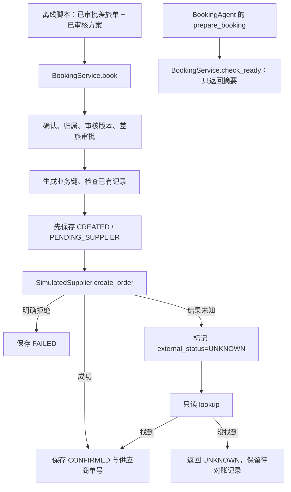

# 阶段 F：预订 Agent 逐步调试（061–067）

你已经学完[前端触发规划 Agent](阶段E-前端触发规划Agent逐步调试.md)。这一篇继续沿着“入口 → 工具 → 业务服务 → 外部结果 → 本地记录”单步观察，重点看：**谁能下单、为什么只能下一单、超时后为什么不能直接重试、取消先改哪里。**

**先说明当前状态（2026-10-25 核对）：预订核心及离线练习已实现；聊天委派到 `BookingAgent`、预订结构化确认和预订结果事件未实现。** 因此这次以现有离线脚本为主要 Debug 入口，浏览器用于理解接线边界。不能照搬规划篇，在聊天里输入“确认预订”就期待进入 `BookingAgent`。

已有[阶段 F 组件指南](阶段F-061-067-调试指南.md)保留完整组件说明；本篇按初次学习的顺序组织，优先跑通一段预订，再看失败分支。编号与验收对应[阶段 F 学习路线](../学习路线/阶段F-061-067.md)。

## 1. 先把规划、预订 Agent 和下单服务分开

举个小例子：你有一张审批通过的“北京 → 上海”差旅单，也有一个审核通过的“综合最佳”方案。现在要预订其中的去程航班。

| 责任 | 规划篇中你已经见过的 | 当前预订实现 |
| --- | --- | --- |
| 形成候选、计算、审核 | `ItineraryPlanAgent` 的五个工具 | 读取同一方案及当前内容版本的审核结论，不能改审核 |
| 模型能调用的工具 | `create_plan`、`search_candidates`、`compute_plan`、`review_plan`、`get_plan` | `prepare_booking`、`query_booking`，都是只读工具 |
| 真正向供应商创建订单 | 没有 | 服务端显式调用 `BookingService.book(..., confirmed=True)` |
| 用户确认 | 规划不等于确认购买 | 目前服务方法检查布尔值；尚未接入聊天中的可信确认流程 |
| 聊天入口 | 主 Agent 可挂载 `itinerary_plan_agent` | 没有挂载 `booking_agent`；`booking` 意图仍挂载差旅管理工具 |

`BookingAgent` 是模型协调层，`BookingService` 是确定性业务层。**当前脚本直接调业务层，不运行预订 Agent 的模型推理循环。** 先学业务规则，再看第 5 节的 Agent 装配，就不会把提示词当成下单事实。



图中没有从 `prepare_booking` 到 `book` 的自动连线：当前代码确实没有这一步。

## 2. 零准备运行与 PyCharm 配置

### 2.1 先跑最小场景

```sh
cd /Volumes/PortableSSD/workspace/gogo-agent
uv sync --frozen
.venv/bin/python --version
PYTHONPATH=src .venv/bin/python scripts/demo_061_067_booking.py --case book
```

本次实测解释器为 Python 3.12.13，AgentScope 为 2.0.8；以 `pyproject.toml`、`uv.lock` 和当前解释器为准。系统 `python3` 可能属于其他环境，下面始终用项目 `.venv/bin/python`。

不需要启动前后端、Redis、真实数据库或模型，不需要途牛 Key。脚本自己创建内存 SQLite 和模拟供应商；它不会加载浏览器练习库，也不会读取规划篇遗留的计划。

预期输出：

```text
== 062–064 门禁与下单 ==
未确认 code=CONFIRMATION_REQUIRED 供应商调用次数=0
首次 resolution=CONFIRMED order_no=SUP000001 amount=1200.00 CNY
重复 resolution=CONFIRMED 同一预订标识=True
供应商创建调用=1 本地记录数=1 状态=CONFIRMED
```

这里的 `1200.00` 是**去程航班**金额，不是整趟行程总价；`CONFIRMED` 也不表示已支付。记录里的 `payment_status` 仍为 `UNPAID`。

### 2.2 建一个直接调脚本的 Debug 配置

| 配置项 | 填写内容 |
| --- | --- |
| Python interpreter | `/Volumes/PortableSSD/workspace/gogo-agent/.venv/bin/python` |
| Script path | `/Volumes/PortableSSD/workspace/gogo-agent/scripts/demo_061_067_booking.py` |
| Working directory | `/Volumes/PortableSSD/workspace/gogo-agent` |
| Environment | `PYTHONPATH=src` |
| Parameters | `--case book` |

以 **Debug** 启动。F8 跨过当前语句，F7 进入函数；若 PyCharm 开启“跳过库代码”，进入 `asyncio.run` 时可直接在实际协程内设断点。下面的行号是本次核对位置，**优先按文件和语句定位**。

### 2.3 隐藏前置：第一次下单前已经跑过哪些步骤

在 [demo_061_067_booking.py:99](../../scripts/demo_061_067_booking.py) 的 `plan_id = lab.reviewed_plan(lab.approved_order())` 设断点。Python 先求参数值，所以真实顺序为：

1. `Lab()` 建业务内存库、模拟供应商和独立的计划内存库，写入 `u001/P6` 档案。
2. `approved_order()` 提交差旅单，再由模拟管理员审批同意。此处的 `confirmed=True` 是**提交差旅申请**，与确认购买是两件事。
3. `reviewed_plan(order_id)` 创建关联差旅单的计划 → 保存模拟候选 → 计算 → 用固定评估器审核“综合最佳”。
4. 才进入 `book()`。在第一个预订调用之前，`lab.supplier.create_calls == 0` 且 `lab.rows() == []`。

脚本把计划服务的“今天”固定在 **2026-10-11**，出行日期固定为 2026-10-20 至 2026-10-22。因此日历已到这些日期之后也能复现，勿把它当成真实购票日期校验。计划 ID、供应商序号和金额可复现；差旅单与审批 ID 使用 UUID，时间戳也会变化。

| 参数 | 会先执行的准备与调用 |
| --- | --- |
| `book` | 一套新 Lab；审批和审核后，依次执行未确认、首次确认、同键重复预订 |
| `lost` | **两套**新 Lab；每套各自审批和审核。先模拟“已创建但响应丢失”，再模拟“未创建且响应丢失” |
| `cancel` | 一套新 Lab；审批和审核后先下去程、酒店两单，再取消，最后验证跨用户取消 |
| `reliability` | 独立的只读重试和异步搜索示例，没有上述建单前置 |
| `breaker` | 新熔断器、假时钟和模拟函数，不下单 |
| `all` | 按以上表格顺序运行，场景间不共享订单 |

## 3. 第一轮：未确认 → 成功 → 同键重复

继续使用 `--case book`。下表中的“执行后”指 F8 跨过该语句，再检查变量；停在 `return` 前，返回动作还没发生。

| 步 | 断点文件与语句 | 第几次命中、进入前状态 | 观察变量与预期 | 下一步及原因 |
| --- | --- | --- | --- | --- |
| B0 | [脚本:99](../../scripts/demo_061_067_booking.py) `plan_id = lab.reviewed_plan(...)` | 初始化后 | F8 后 `plan_id` 已生成；供应商调用 0，本地预订 0 | 前置完成，进入第一次 `book` |
| B1 | [service.py:142](../../src/gogo_agent/booking/service.py) `if not confirmed:` | `book` 第 1 次：`confirmed=False` | 第一次 F8 到下一行 `raise`，再 F8 才抛 `BookingError`，`code=CONFIRMATION_REQUIRED`；调用次数仍为 0 | 脚本捕获后进入第 2 次 `book`，不是供应商重试 |
| B2 | [service.py:144](../../src/gogo_agent/booking/service.py) `plan, proposal = self._gate(...)` | 第 2 次：`confirmed=True` | `user_id='u001'`、`proposal_tag='综合最佳'`、`leg='outbound'` | F7 进 `_gate` 看审核与审批 |
| B3 | [service.py:115](../../src/gogo_agent/booking/service.py) `review = plan.last_review` | 计划已计算；`proposal` 已选出 | `plan.review_is_current()` 为真；`review.proposal_tag` 相同，`review.verdict.value == 'PASS'` | 同一代表方案、同一内容版本的审核才有效 |
| B4 | [service.py:123](../../src/gogo_agent/booking/service.py) `order = self.travel.get_order(...)` | `plan.order_id` 非空 | 执行后 `order.status.value == 'APPROVED'`；计划与差旅单都按本人查 | 通过后回到 `book` 生成请求 |
| B5 | [service.py:152](../../src/gogo_agent/booking/service.py) `booking_id = booking_id_for(...)` | 尚未写预订 | 执行后 ID 以 `bk_` 开头；`payload['amount']=='1200.00'`；`existing` 随后为 `None` | 检查同行程段已有确认单，再插入待处理行 |
| B6 | [service.py:158](../../src/gogo_agent/booking/service.py) `self._insert_pending(...)` | 本地预订 0 | F8 后本地预订 1：`status='CREATED'`、`external_status='PENDING_SUPPLIER'`，供应商调用仍为 0 | **事务已提交**，才开始外部调用 |
| B7 | [service.py:203](../../src/gogo_agent/booking/service.py) `order = self.supplier.create_order(...)` | 本地已留请求证据 | F8 后模拟供应商调用 1；`order.order_no=='SUP000001'` | 正常返回进入 `_finish_confirmed` |
| B8 | [service.py:251](../../src/gogo_agent/booking/service.py) `row.status = BookingStatus.CONFIRMED.value` | 已取得供应商结果 | 继续执行后续字段赋值，直到事务退出、服务返回，再看本地状态与外部状态均为 `CONFIRMED`、外部单号非空；一次 F8 只完成当前赋值 | 返回 `BookingOutcome` 给脚本 |
| B9 | [service.py:154](../../src/gogo_agent/booking/service.py) `if existing is not None:` | `book` 第 3 次；参数与第 2 次相同 | 仍先过 `_gate`；`booking_id` 相同，`existing` 非空 | 进入 `_replay`，跳过 `_insert_pending/_execute` |
| B10 | [service.py:218](../../src/gogo_agent/booking/service.py) `if row['status'] == ...` | 已有确认记录且摘要相同 | 返回已有 `CONFIRMED`；供应商调用 1，本地记录 1 | 三次服务调用结束 |

### 在断点里核对四类事实

停在[脚本:108](../../scripts/demo_061_067_booking.py)打印之前，在 Watches / Evaluate 中看：

```python
lab.supplier.create_calls
[(r.booking_id, r.status, r.external_status, r.external_order_no,
  str(r.total_amount), r.currency, r.payment_status) for r in lab.rows()]
lab.plans.get("u001", plan_id).content_version
first.booking_id == second.booking_id
```

分别应为：`1`；只有一行、金额 `1200.00/CNY`、状态 `CONFIRMED/CONFIRMED`、支付 `UNPAID`；当前计划内容版本；`True`。也可展开 `lab.supplier.orders` 对照请求键和供应商单号。

不要在 Scalar 或外部 SQLite 客户端找这行：脚本使用进程内存库，HTTP 服务使用另一套对象和数据库。退出脚本后这些练习记录不保留。计划表也在另一套内存库中，不能假定它和 `booking_record` 共用事务。

### 业务键为什么能拦住重复请求

入口见 [booking_id_for](../../src/gogo_agent/booking/service.py)：

```text
user_id | plan_id | content_version | proposal_tag | leg
                         ↓ SHA-256 截取
                    bk_...业务标识
```

本地 `booking_id` 唯一，供应商也收到这个 ID 作为请求标识；另用 payload hash 检查同键不同内容。它不同于取消时调用方传入的 `idempotency_key`。

**已验证的范围是同一业务键的串行重复请求。** 不要因此推导出任意并发、换版本、换方案都不会重复：第 9 节列出当前边界。

## 4. 第二轮：响应丢失，为什么不能“再下一单”

把 IDE Parameters 改成 `--case lost`，或运行：

```sh
PYTHONPATH=src .venv/bin/python scripts/demo_061_067_booking.py --case lost
```

先预测：你只知道调用抛异常，能否断定供应商没有建单？然后对照两种输出：

```text
已生成订单但响应丢失 resolution=CONFIRMED 供应商创建调用=1
未生成订单且响应丢失 resolution=UNKNOWN/UNKNOWN 供应商创建调用=1 本地状态=CREATED
```

| 步 | 断点与触发 | 看什么、预期 | 后续去向 |
| --- | --- | --- | --- |
| L1 | [supplier.py:85](../../src/gogo_agent/booking/supplier.py) `mode = self._next_mode()`，两套 Lab 各首次创建 | 第一套为 `lost_after_commit`：先保存供应商订单再抛异常；第二套为 `lost_before_commit`：不保存订单就抛异常 | 两者都进入服务端未知结果分支 |
| L2 | [service.py:208](../../src/gogo_agent/booking/service.py) `self._mark_unknown(...)` | 执行后本地 `status='CREATED'`，`external_status='UNKNOWN'` | **不是**把本地 `status` 改为 `UNKNOWN`；随后只读对账 |
| L3 | [service.py:228](../../src/gogo_agent/booking/service.py) `order = call_read_with_retry(...)` | 第一套查到 `SupplierOrder`；第二套查到 `None` | 查到则 `_finish_confirmed`；查不到返回 `resolution='UNKNOWN'` |
| L4 | [脚本:126](../../scripts/demo_061_067_booking.py) `again = lab.service.book(...)`，仅第二套执行 | 仍是同一内容版本、同一业务键；`create_calls==1` | 重新过门禁后 `_replay → _reconcile`，不会再次 `create_order` |

第一套的保存顺序是：本地 pending → 供应商已建单 → 响应丢失 → 本地标未知 → 查询找到 → 本地确认。第二套是：本地 pending → 响应丢失 → 标未知 → 查询无结果 → 保持未知；同键再调用仍只查询。

`lookup` 返回 `None` 也是一次正常查询返回，不会因为“没查到”自动连续查三次。只有符合重试条件的只读异常才退避重试。`query_booking` 工具仅查本地库，**不会触发上述对账**。

## 5. 第三轮：看 BookingAgent 到底拿到了什么

这一步使用已有测试作为 Debug 入口，不调用真实模型：

```sh
PYTHONPATH=src .venv/bin/python -m pytest tests/test_061_067_booking.py -q -k 'booking_toolkit or booking_agent_is_assembled or writable_tools_are_disjoint or planning_and_review_never_book'
```

PyCharm 可新建 **Python tests → pytest** 配置：Working directory、Interpreter、Environment 沿用第 2 节；Target 指向 `tests/test_061_067_booking.py`，Additional Arguments 使用上面命令的 `-q -k '...'` 部分。也可在对应测试函数左侧直接 Debug。这里用具体名称筛选：`-k test_061` 会匹配文件名，从而跑完整个文件。

| 步 | 断点与触发 | 应观察的内容 |
| --- | --- | --- |
| A1 | [tools.py:30](../../src/gogo_agent/booking/tools.py) `user_id = request.user_id`；先 Debug `test_061_booking_toolkit_has_no_writable_tool_and_no_plan_or_review_mutation` | 执行后 `user_id='u001'`；此时嵌套函数尚未定义，继续到 A1b |
| A1b | [tools.py:56](../../src/gogo_agent/booking/tools.py) `return Toolkit(tools=[` | 两个嵌套函数已经定义；`prepare_booking.__code__.co_freevars` 包含 `service`、`user_id`，闭包保存身份；返回后在 A2 看模型 schema 不含身份参数 |
| A2 | [测试:136](../../tests/test_061_067_booking.py) `assert names == ...` | `names == {'prepare_booking', 'query_booking'}`；没有下单、取消或修改审核工具 |
| A3 | [agent.py:20](../../src/gogo_agent/booking/agent.py) `return Agent(...)`；Debug `test_061_booking_agent_is_assembled_with_policy_prompt` | 调用方传入 model、toolkit、state；返回对象名 `BookingAgent`，`max_iters=8`、模型重试 0 |
| A4 | [测试:156](../../tests/test_061_067_booking.py) `assert book_w == set()`；Debug `test_061_writable_tools_are_disjoint_across_master_planning_and_booking_toolkits` | 预订工具全部只读；规划、管理工具面也没有 `book_flight` |

这些测试验证装配与工具 schema，**没有调用 `Agent.reply()`，也不会命中 `prepare_booking` 函数体**。函数体的实际责任按代码顺序读：

1. [tools.py:35](../../src/gogo_agent/booking/tools.py) 调 `service.check_ready`，执行门禁并生成摘要。
2. 门禁不满足时，返回对应 `errorCode`。
3. 门禁满足时，仍返回 `success=false / errorCode=CONFIRMATION_REQUIRED`，附带 `data` 摘要；这是“等待确认”，没有下单。
4. `query_booking` 调阶段 D 的 `get_booking`，只读当前用户的本地记录，不联系供应商。

这也解释了为什么把提示词改成“直接帮用户订好”没有用：工具面根本没有下单入口。反过来，仅有 `confirmed=True` 这个参数也没有实现聊天的可信用户确认；它依赖未来的认证调用方正确传入。

## 6. 第四轮：取消顺序与跨用户隔离

```sh
PYTHONPATH=src .venv/bin/python scripts/demo_061_067_booking.py --case cancel
```

脚本先创建去程与酒店两单，所以进入第一次取消时 `create_calls==2`、本地记录 2，取消调用次数尚为 0。

| 步 | 断点与触发 | 变量与预期 | 下一步 |
| --- | --- | --- | --- |
| C1 | [service.py:275](../../src/gogo_agent/booking/service.py) `def cancel(...)` 的首条语句；第 1 次是航班 | 本人、已确认、记录状态 `CONFIRMED` | 调阶段 D `travel.cancel_booking` |
| C2 | [travel/service.py:485](../../src/gogo_agent/travel/service.py) `self.booking_gateway.cancel(...)`；航班取消 | 供应商确认成功，`supplier_cancelled=True` | 随后本地状态变 `CANCELLED` 并写取消审计 |
| C3 | [booking/service.py:287](../../src/gogo_agent/booking/service.py) `self._cancel_hotel_at_supplier(...)`；第 2 次是酒店 | 进入前酒店本地仍为 `CONFIRMED`，有供应商单号 | **先**取消酒店供应商订单，再进入阶段 D |
| C4 | [booking/service.py:289](../../src/gogo_agent/booking/service.py) `result = self.travel.cancel_booking(...)` | 酒店供应商已确认取消 | 更新本地；外层补充供应商取消事实 |
| C5 | [脚本:145](../../scripts/demo_061_067_booking.py) 以 `u002` 取消航班 | 记录属于 `u001` | `BOOKING_NOT_FOUND / 404`，不触碰供应商 |

预期输出包含：`供应商取消调用=2`、`FLIGHT:CANCELLED, HOTEL:CANCELLED`、跨用户 `BOOKING_NOT_FOUND`、本地记录总数 2。取消改变原记录状态，不新增一张“取消订单”。

再验证酒店供应商失败时，本地为什么不能先取消：

```sh
PYTHONPATH=src .venv/bin/python -m pytest tests/test_061_067_booking.py::test_063_hotel_cancel_cancels_supplier_first_and_keeps_local_state_on_failure -q
```

测试先预订酒店，再从模拟供应商字典中删除该单。取消返回 `SUPPLIER_CANCEL_FAILED`，本地仍为 `CONFIRMED`。这模拟的是供应商未确认取消；不能将它外推为所有取消超时都已恢复。

**注意实际入口的差异**：HTTP `POST /api/my-travel/bookings/{booking_id}/cancel` 直接调用阶段 D 服务；该服务的酒店分支只改内部状态。它没有经过本节的 `BookingService.cancel` 酒店补充逻辑，不能与本脚本的供应商取消结果混为一谈。聊天的 `request_booking_cancellation` 也只提示独立确认，不执行取消。

## 7. 门禁失败和工具可靠性：先预测，再用现有场景验证

### 7.1 门禁失败

```sh
PYTHONPATH=src .venv/bin/python -m pytest tests/test_061_067_booking.py -q -k 'test_062 or test_064'
```

| 先写下预测 | 预期结果 | Debug 入口与观察点 |
| --- | --- | --- |
| 差旅单已提交，但管理员尚未同意，能订吗？ | `APPROVAL_NOT_APPROVED`，供应商调用 0 | `test_062_gates_refuse_unapproved_foreign_unreviewed_and_changed_plans` 第一段 → `_gate` 中 `order.status` |
| `u002` 能用 `u001` 的计划吗？ | `PLAN_NOT_FOUND` | 同一测试第二段 → `PlanService.get` 的本人查询 |
| 主观评估通过，但最终审核失败，能订吗？ | `REVIEW_NOT_PASSED` | 同一测试第三段；看最终 `review.verdict` |
| 审核后重新计算，旧审核还能用吗？ | `REVIEW_REQUIRED` | 同一测试最后一段；先命中 `compute`，再命中 `_gate` |
| 计划未关联差旅单，能订吗？ | `APPROVAL_REQUIRED` | `test_062_plan_without_linked_order_cannot_book` |
| 供应商明确拒绝，同键再试会重新下单吗？ | 两次均 `FAILED`，创建 1 次 | `test_062_rejected_booking_is_failed_and_replay_does_not_resend` → `_replay` 的失败分支 |
| 旧去程已确认，新版本方案能再订去程吗？ | `BOOKING_ALREADY_CONFIRMED`；旧单取消后新版本可订 | `test_064_replanned_leg_cannot_book_twice_until_old_booking_is_cancelled`；观察每轮版本、旧记录状态 |

组合测试会先准备多套隔离对象；不同用户、失败审核与旧审核用的并非同一套 Lab。首次学习可只在测试中的目标 `book` 行设断点，再进入服务，避免在准备步骤反复停住。

### 7.2 重试、并行与熔断

```sh
PYTHONPATH=src .venv/bin/python scripts/demo_061_067_booking.py --case reliability
PYTHONPATH=src .venv/bin/python scripts/demo_061_067_booking.py --case breaker
```

| 练习 | 断点 | 应看到什么 |
| --- | --- | --- |
| 只读函数前两次失败、第 3 次成功 | [reliability.py:44](../../src/gogo_agent/booking/reliability.py) `call_read_with_retry` | 总尝试 3 次，记录退避 `[3.0, 6.0]`；脚本注入列表记录等待，不真正睡 9 秒 |
| 三个独立搜索并发 | [reliability.py:113](../../src/gogo_agent/booking/reliability.py) `async with semaphore:` | 有界并行，各自收到 `u001`；一个失败不抹掉其他结果。耗时受机器负载影响 |
| 天气连续失败 3 次后再调用 | [reliability.py:160](../../src/gogo_agent/booking/reliability.py) `if self.state is CircuitState.OPEN:` | 第 4 次返回 `CIRCUIT_OPEN`，实际外呼仍为 3 次 |
| 假时钟推进到 60 秒后再探测 | [reliability.py:209](../../src/gogo_agent/booking/reliability.py) `ToolBreakerRegistry.call` | 探测失败后回到 `OPEN`，外呼变 4 次；其他工具仍可用 |

`reliability` 里的只读重试默认只重试 `OSError` 及其子类，不是任意错误。下单写调用不套这个重试；熔断组件默认只监控 `query_weather`、`query_destination_news`，尚未包进真实客户端或预订供应商调用。它们有独立演示，不代表整条聊天链路已经自动使用这些机制。

## 8. 与规划篇对照：前端、Java 和 Python 各到了哪里

### 8.1 当前浏览器能说明什么

若已经开着规划篇的练习前后端，可新建会话发送“请预订这个方案”，沿下面的静态路径观察。此路线会调用已配置的聊天模型，不属于上述离线验证；本次没有重新发起模型请求。

| 顺序 | 断点或证据 | 当前实现应如何理解 |
| --- | --- | --- |
| U1 | [chat.ts:38](../../frontend/src/api/chat.ts) `sendChatMessageSSE` | 仍只发送通用 `POST /api/chat/{sessionId}`，body 是 `message`，没有专用预订调用 |
| U2 | [rules.py:227](../../src/gogo_agent/intent/rules.py) `IntentRuleMatcher.match` | 新会话中该句 L1 命中 `booking`；离线规则调用已核验。短句“确认”需要历史，不等同于此句 |
| U3 | [executor.py:287](../../src/gogo_agent/chat/executor.py) `has_manage = any(...)` | `BOOKING` 在 `MANAGE_INTENTS` 中，所以 `has_manage=True`，本句 `has_plan=False` |
| U4 | [executor.py:355](../../src/gogo_agent/chat/executor.py) `name=self.MANAGE_TOOL_NAME` | 主 Agent 获得 `itinerary_manage_agent`；是否实际委派仍取决于模型。没有 `booking_agent` |
| U5 | [travel/tools.py:259](../../src/gogo_agent/travel/tools.py) `request_booking_cancellation` | 即使模型选了取消请求工具，也只查归属并提示确认，不执行供应商取消 |
| U6 | [ChatWindow.tsx:411](../../frontend/src/components/ChatWindow.tsx) `case 'booking_result':` | 前端具备消费能力；当前 Python 聊天服务没有这类事件生产路径，不能据此期待预订卡片 |

前端 `BookingResultCard` 负责展示订单和支付链接，没有确认下单按钮；它的存在不证明 BookingAgent 已接线。`event: booking_result` 是 SSE 事件名，JSON 中写一个同名 `type` 字段也不能替代服务端发送事件。

规划篇的 `extra.tool_calls`、`extra.timeline` 和模型日志用于检查真实聊天执行；本篇离线脚本没有 SSE、业务聊天消息或 AgentState 保存，所以看不到这些记录。反过来，聊天里出现“预订成功”的文字，也不能替代供应商结果与本地记录。

### 8.2 Java → Python 的责任对照

Java 基线根目录：`/Users/shenmingjie/workSpace/LLMentor-teach/gogo-agent`。下表链接指向该目录中的实际源码；本次没有启动 Java 服务或真实下单。

| Java 实际入口 | 当前 Python 入口 | 相同点与差异 |
| --- | --- | --- |
| [MasterAgent.java:117](/Users/shenmingjie/workSpace/LLMentor-teach/gogo-agent/src/main/java/com/gogo/travel/agent/MasterAgent.java) 注册 `booking_agent` | [chat/executor.py:269](../../src/gogo_agent/chat/executor.py) `_build_agent` | Python 尚未注册预订子 Agent；当前 `booking` 意图进入管理 Agent |
| [BookingAgent.java:61](/Users/shenmingjie/workSpace/LLMentor-teach/gogo-agent/src/main/java/com/gogo/travel/agent/BookingAgent.java) `build()`，注册工具、Skill 和 Hook | [booking/agent.py:18](../../src/gogo_agent/booking/agent.py) `build_booking_agent` | 都组装模型与工具；Python 标准工具集只有门禁与本地查询 |
| [BookingAgent.java:108](/Users/shenmingjie/workSpace/LLMentor-teach/gogo-agent/src/main/java/com/gogo/travel/agent/BookingAgent.java) 注册 `tuniu-cli`；[BookingPersistenceHook.java:104](/Users/shenmingjie/workSpace/LLMentor-teach/gogo-agent/src/main/java/com/gogo/travel/agent/hook/BookingPersistenceHook.java) `handlePostActing` 解析 shell 结果后保存 | [BookingService.book](../../src/gogo_agent/booking/service.py) → `_execute` → `SupplierGateway.create_order` | Python 先留 pending，再调模拟供应商，再保存确定结果；没有 Java 式下单 CLI 后置 Hook 路径 |
| [BookingWriteTools.java:61](/Users/shenmingjie/workSpace/LLMentor-teach/gogo-agent/src/main/java/com/gogo/travel/agent/tools/BookingWriteTools.java) `cancelBooking` | [BookingService.cancel](../../src/gogo_agent/booking/service.py) → [TravelBusinessService.cancel_booking](../../src/gogo_agent/travel/service.py) | Python 酒店外层先取消供应商；阶段 D 直调的酒店分支仍只改内部状态 |
| [BookingPersistenceHook.java:229](/Users/shenmingjie/workSpace/LLMentor-teach/gogo-agent/src/main/java/com/gogo/travel/agent/hook/BookingPersistenceHook.java) `emitBookingResult`，发送 `booking_result` | 前端保留同名事件消费分支 | Java 有静态生产链；当前 Python 没有对应发送，不能套用 Java 的页面完成标准 |
| [TravelOrderService.java:51](/Users/shenmingjie/workSpace/LLMentor-teach/gogo-agent/src/main/java/com/gogo/travel/business/order/service/TravelOrderService.java) `createAndSubmit` | `TravelBusinessService.submit_order` | 创建差旅申请、提交审批；不是向供应商订机票或酒店 |

Java 的确认与先检查审批主要依赖提示词及工具调用；Python 的 `_gate` 是服务端规则，但当前没有把聊天确认接到它。Java 当前模块未见与 Python 同责任的统一 `BookingService`，不要仅凭类名相似寻找逐行对应。

### 8.3 本轮 Python 语法与生命周期

| 语法或对象 | 在本篇哪里看到 | Java 工程师怎么理解 |
| --- | --- | --- |
| `proposal_tag=...`、`leg=...` | `book` 调用；定义里的 `*` 之后 | 必须按名称传参；`confirmed` 不能靠参数位置误传 |
| 嵌套函数与闭包 | `build_booking_toolkit` 保存 `user_id` | 类似保存构造参数的对象，但这里是函数捕获局部变量；模型不提供身份 |
| `Protocol` | `SupplierGateway` | 结构接口：方法形状符合即可，无须显式 `implements`；演示传入模拟实现 |
| `with repo.transaction()`、`yield` | [repository.py:28](../../src/gogo_agent/travel/repository.py) | `yield` 前进入事务，块结束后提交，异常回滚；不是覆盖供应商与本地库的分布式事务 |
| `async def`、`await`、`asyncio.run` | 预先审核、并行搜索 | `async def` 调用先得到协程，`asyncio.run` 才驱动运行；`await` 等待并允许事件循环调度，不等于新开线程 |
| `async with semaphore` | 并行只读搜索 | 进入取得名额，退出释放；不是数据库锁 |
| `lambda` | `today=lambda: TODAY`、`sleep=lambda _s: None` | 注入时钟或等待函数；模型与供应商未因此变成真实服务 |
| `Decimal`、ORM 快照 | 金额和本地记录 | 类似 `BigDecimal`；交易内读取，避免把会话生命周期与业务对象生命周期混为一谈 |

## 9. 数据落点、已验证范围与当前缺口

| 数据 | 本篇实际落点 | 能证明什么、不能证明什么 |
| --- | --- | --- |
| 计划、内容版本与审核 | `lab.plans` 的独立内存计划库 | 可读当前版本审核；不复用浏览器里之前生成的计划 |
| 供应商请求与订单 | `lab.supplier.orders` 字典、调用计数 | 模拟外部事实；不证明真实航司、酒店行为 |
| 预订记录 | 业务内存库 `booking_record` | pending、成功、失败、未知与取消状态；不表示付款成功 |
| 业务审计 | `business_action_audit` | 差旅提交和阶段 D 取消有写入；当前 `BookingService.book` 没有写下单审计 |
| 聊天历史、AgentState、活跃路由 | 本脚本不保存 | 不能用脚本结果证明聊天续跑、SSE 卡片或历史回放生效 |

不要由测试名 `...counted_and_audited` 推断每次下单都有审计：现有该测试主要断言调用次数和记录状态。本次额外只读检查显示，成功下单、响应丢失、拒绝场景的审计表都只有准备阶段的 `submit`。

当前需要保留的限制：

- **跨版本未知单保护不足**：本次隔离复现中，旧版本下单返回 `UNKNOWN` 后，重新计算并审核生成新内容版本，再下同一去程会创建新键；创建次数从 1 变成 2、本地记录从 1 变成 2。代码只拦已有 `CONFIRMED` 的同差旅单同段记录。不要通过改版本或换键处理未知订单。
- **未证明并发下单唯一**：唯一键可拒绝冲突插入，但当前测试未覆盖并发竞争；无跨供应商调用的锁，不能宣称完整的 exactly-once。
- **一次只预订一段**：去程、酒店、返程分别调用；部分成功后没有整单原子回滚或自动补偿。
- **未知结果无后台恢复**：同键调用时只读对账；没有定时对账或供应商回调。当前也未校验供应商返回的请求 ID、金额、币种是否与本地请求一致。
- **酒店取消审计有差异**：外层返回供应商已取消，但阶段 D 审计快照中的 `supplier_cancelled` 仍可能为 `false`；不能拿其中一份替代完整核验。
- **当前验证环境有限**：仅 SQLite、模拟供应商、固定评估器；未运行真实途牛、MySQL、支付、Java 服务或 BookingAgent 模型推理。聊天接线与结构化确认也不在本次实现范围内。

这些是学习时需要解释的现状，不是要求你在本轮自行补齐的功能。继续后续阶段前，按学习路线核对阶段出口，不能把模拟供应商验收等同于生产闭环。

## 10. 最后一次连贯复现与学习验收

```sh
PYTHONPATH=src .venv/bin/python scripts/demo_061_067_booking.py --case all
PYTHONPATH=src .venv/bin/python -m pytest tests/test_061_067_booking.py -q --tb=short
```

本次运行：演示全部完成，测试 **27 passed**。它验证已有模拟路径，不补足第 9 节列出的缺口。

关掉文档，先预测、再用断点说明下面六题：

1. **为什么 `prepare_booking` 成功检查后还返回 `CONFIRMATION_REQUIRED`？** 因为它只准备摘要，没有执行购买权限。
2. **`book` 调三次，为什么供应商只创建一次？** 第一次未确认被拒绝；第二次创建；第三次门禁通过后命中同键已有记录。
3. **`UNKNOWN` 为什么不能当 `FAILED`？** 异常不能证明供应商没建单；应查询事实，同键不重新创建。
4. **旧审核、旧内容版本、旧确认单分别在哪挡住请求？** `_gate` 校验当前审核；业务键包含内容版本；跨版本同段已有确认单由 `_confirmed_leg_exists` 拦截。
5. **为什么浏览器里找不到预订 Agent，也不出现预订结果卡片？** 当前聊天没有注册该 Agent，也没有发送对应结果事件；前端消费代码的存在不等于接线完成。
6. **酒店取消失败为什么本地仍应是 `CONFIRMED`？** 外层先要供应商确认，成功后才更新本地；阶段 D 直调酒店取消是不同路径。

能亲自复现成功、同键重复、两种响应丢失和跨用户拒绝，并区分**模拟供应商事实、本地预订、审计、聊天记忆**，就完成了本篇的学习目标。
